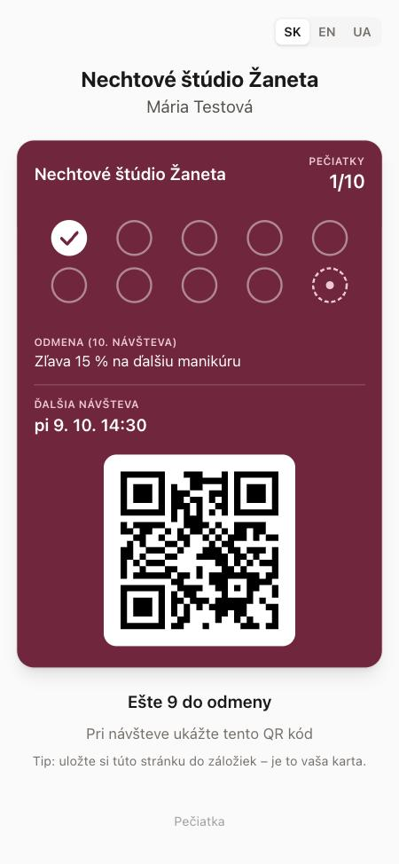
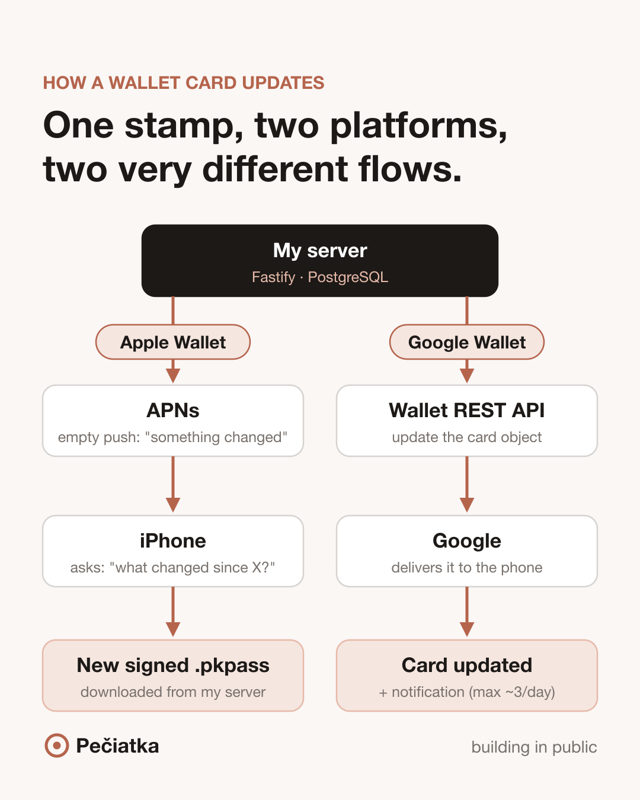
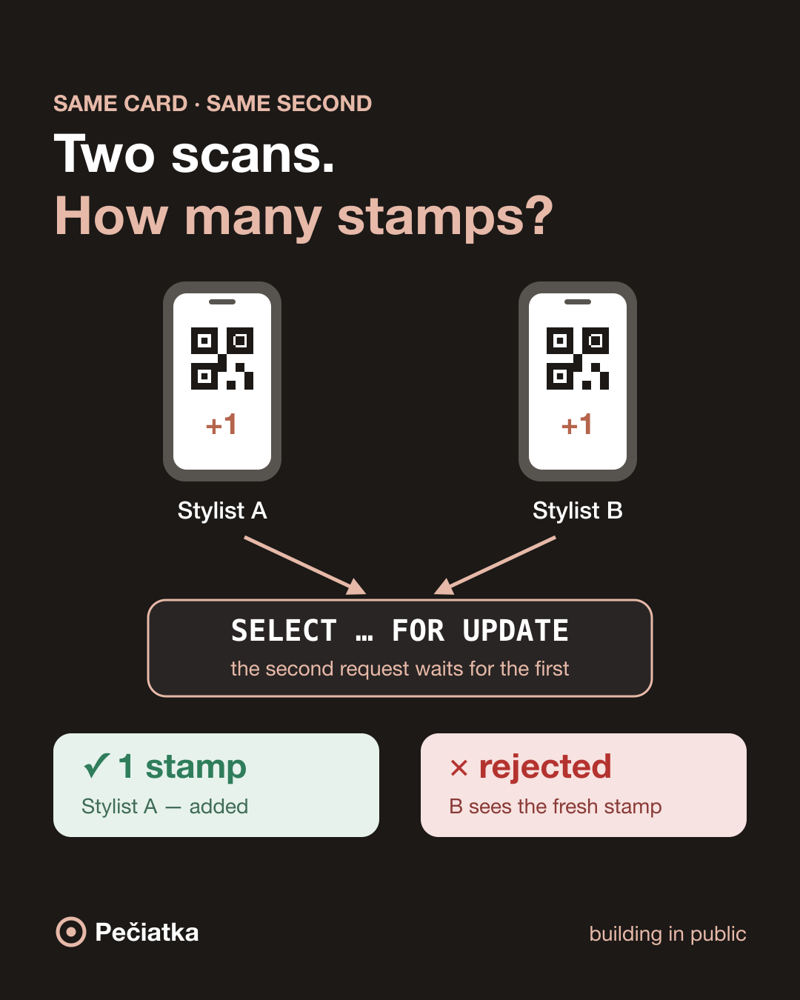

# Pečiatka — digital loyalty cards for small salons

**Pečiatka** (Slovak for *"stamp"*) replaces paper stamp cards in small beauty salons — nail studios, barbershops, hair and brow/lash salons — with a digital loyalty card that lives in **Apple Wallet** and **Google Wallet**.

A client scans a QR code at the counter and gets the card on her phone in under a minute. At checkout, the stylist scans the card with their own phone and adds a stamp — the card in the client's Wallet updates itself and shows a notification. After N visits the reward appears automatically.

No app to install, no account for the client, setup in about 10 minutes for the salon.

<p align="center">
  
</p>

## Features

**At the counter** — the main screen, built for a receptionist or the stylist at checkout
- QR scanner opens first (installable PWA); search by name or the last digits of a phone number as a fallback
- Register a new client right at the counter in ~20 seconds: name and phone, the first stamp is added, and a QR code on screen lets the client add the card to her phone
- One big "+1 stamp" button; a ready reward is shown on top and redeemed with one tap
- Set the client's next appointment — it appears on the card, with a reminder a day before
- After a stamp the screen returns to the scanner automatically, ready for the next client
- Undo a mistaken stamp within 24 hours

**Salon owner**
- Loyalty card setup in one screen: reward, number of stamps, color preset and logo, with a live card preview
- Printable QR poster (PDF) for the counter
- Clients list with three key numbers: total clients, visits and returning clients in the last 30 days
- Optional staff logins (e.g. receptionists on shifts) with an activity log of every action
- GDPR tools: export all data of a client as JSON, delete (anonymize) a client

**Client**
- Sign-up page: name, phone or email, explicit consent
- Card in Apple Wallet / Google Wallet, or a web card with a QR code
- Push notifications for new stamps, rewards and appointment reminders

**Everywhere:** Slovak, English and Ukrainian; times stored in UTC and shown in the salon's time zone (Europe/Bratislava).

## Tech stack

| Layer | Technologies |
|---|---|
| Frontend | React 19, TypeScript, Vite, Tailwind CSS, TanStack Query, React Hook Form, react-i18next, PWA |
| Backend | Node.js, Fastify, TypeScript, Zod |
| Database | PostgreSQL, Prisma ORM |
| Wallet | `passkit-generator` (Apple), APNs over HTTP/2, Google Wallet REST API, RS256-signed JWT |
| Other | Sharp (image processing), PDFKit (posters), Vitest, Docker |

Monorepo with pnpm workspaces: `apps/api`, `apps/web`, and `packages/shared` (Zod schemas and DTOs shared by both sides).

## Engineering highlights

### Updating a card that lives in someone else's app



The two Wallet platforms work very differently:

- **Apple Wallet** — the card is a signed `.pkpass` file. When it changes, the server sends an empty push through APNs; the iPhone then calls the server's **PassKit Web Service**, asks which cards changed since its last sync, and downloads a freshly signed pass.
- **Google Wallet** — the card is an object stored by Google. The server updates it through the Wallet REST API and Google delivers the change. Notifications are separate messages, limited to about 3 per card per day.

Each event (stamp, reward, reminder) produces exactly **one** notification: through a back-of-card field with `changeMessage` on Apple, and a `TEXT_AND_NOTIFY` message on Google.

<br clear="right">

### No double stamps, no lost updates



- Every stamp runs in a transaction that starts with `SELECT … FOR UPDATE` on the card row. Two stylists scanning the same card at the same moment get exactly one stamp; the second request sees the fresh timestamp and hits the cooldown. There is an integration test that fires four simultaneous requests.
- **Outbox pattern:** the Wallet update job is written in the same transaction as the stamp. A worker sends it to Apple/Google and retries with exponential backoff, so a temporary outage never leaves a card out of sync.
- The business rules (cooldown, rewards, undo) are pure functions in `apps/api/src/domain/stamping.ts`, unit-tested without a database.

<br clear="right">

### Multi-tenancy and security
- Each salon is a tenant. A request guard resolves the salon from the session and checks an active membership; handlers only ever use that salon ID. A card from another salon looks like it doesn't exist (404).
- Sessions in httpOnly SameSite cookies; only a SHA-256 hash of the token is stored. Passwords hashed with Argon2. Rate limits on login, sign-up and public endpoints.
- Every change is written to an audit log in the same transaction as the change itself.

### GDPR by design
- Minimal data: a name plus a phone number or email.
- Consent is stored with a timestamp and the version of the consent text.
- One-click JSON export of everything stored about a client.
- Deletion anonymizes personal data and voids the card in Apple/Google Wallet, while keeping anonymous visit statistics intact.

## Tests

94 automated tests (Vitest):
- unit tests for the stamping rules,
- integration tests against a real PostgreSQL database: authentication, tenant isolation, roles, invitations, stamping, cooldown, concurrent scans, rewards, undo, reminders, customer search, GDPR export/deletion, statistics,
- Wallet tests with self-signed certificates and mocked network calls: `.pkpass` contents and signature, the full PassKit Web Service flow, APNs token cleanup, retries, Google JWT signature and object updates.

```bash
pnpm test
```

## Running locally

Requirements: Node.js 22+ and pnpm. PostgreSQL runs as an npm package, so Docker is not required (a `docker-compose.yml` is included if you prefer it).

```bash
pnpm install
cp .env.example .env
pnpm db                                        # terminal 1: PostgreSQL on :5434
pnpm --filter api exec prisma migrate deploy   # once, and after new migrations
pnpm dev                                       # terminal 2: API on :3001, web on :5174
```

Or, on macOS, start everything with one command (`./start.sh --phone` also opens a temporary HTTPS address for testing on a phone; `./stop.sh` stops it all):

```bash
./start.sh
```

Open http://localhost:5174 and register a salon. Without a mail provider key, emails (invitations, password reset) are printed to the API console.

Apple Wallet and Google Wallet are optional: without credentials the Wallet buttons are hidden and clients use the web card. See [DEPLOY.md](DEPLOY.md) for credentials and deployment (Docker, Railway/Render + Neon).

## Project structure

```
apps/
  api/            Fastify API
    prisma/       database schema and migrations
    src/domain/   pure business rules
    src/modules/  routes: auth, staff, program, public, cards, customers, stats, wallet
    src/services/ cards, images, Apple & Google Wallet, sync worker
    test/         unit and integration tests
  web/            React PWA (owner, staff and client screens)
packages/
  shared/         Zod schemas and types used by both apps
```

## Status

Working MVP. Next steps: deployment, Wallet testing on real devices, and a pilot with salons in Bratislava. Planned: "time for your next visit" reminders based on each client's visit rhythm, Google review prompts, and referral rewards.

## Author

**Nikita Kolotusha** — product idea, scope, architecture and development.
GitHub: [@h010grams](https://github.com/h010grams)

Built with AI-assisted development (Claude Code); product decisions, architecture choices, testing and review by the author.
